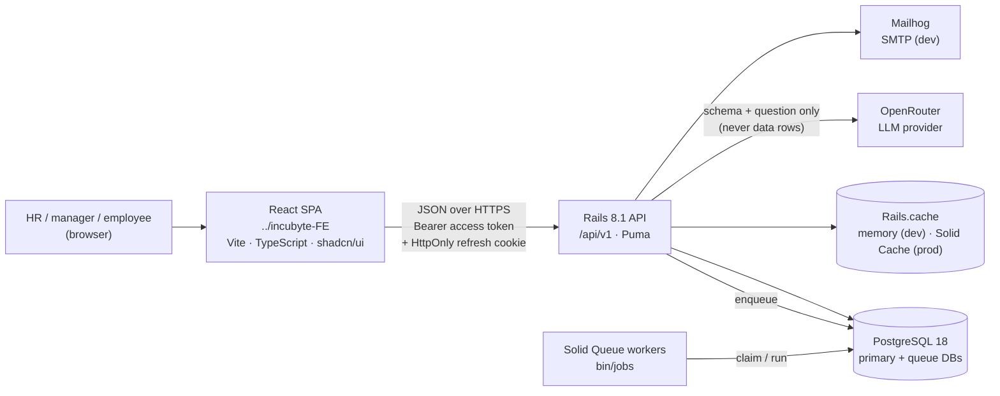
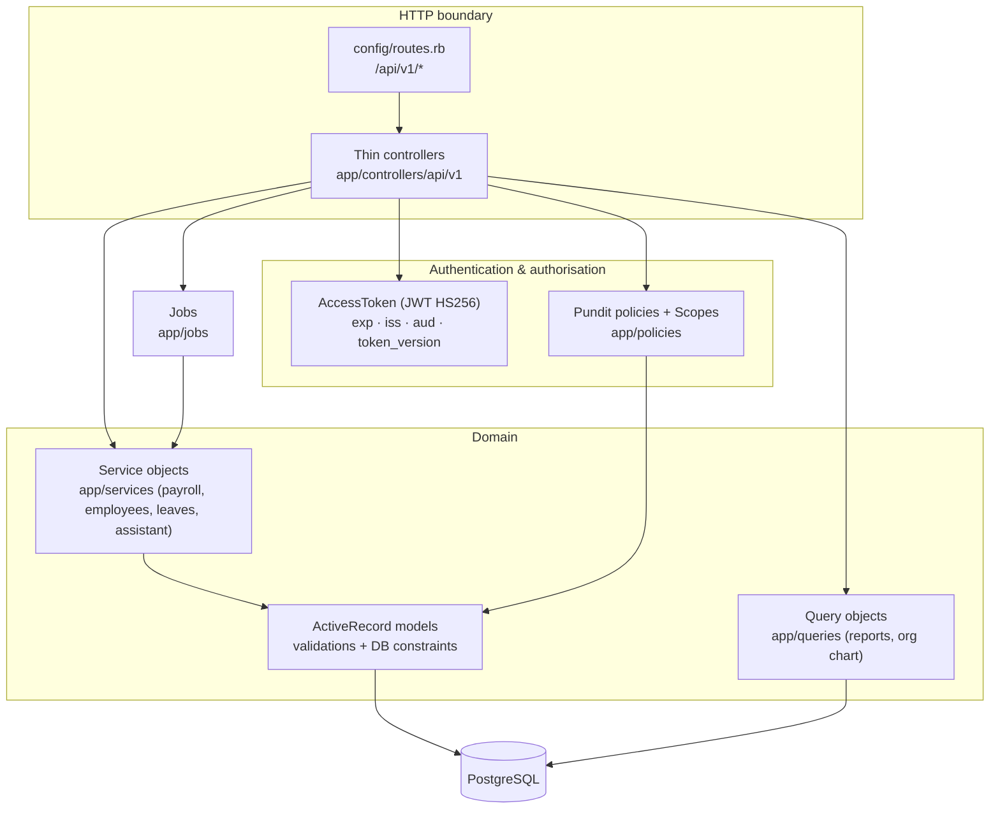
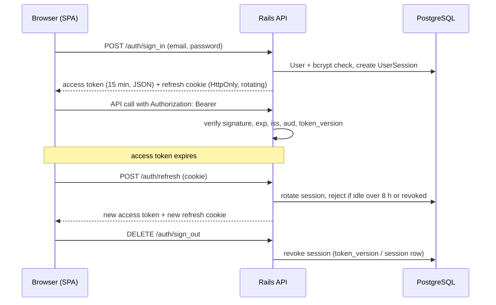
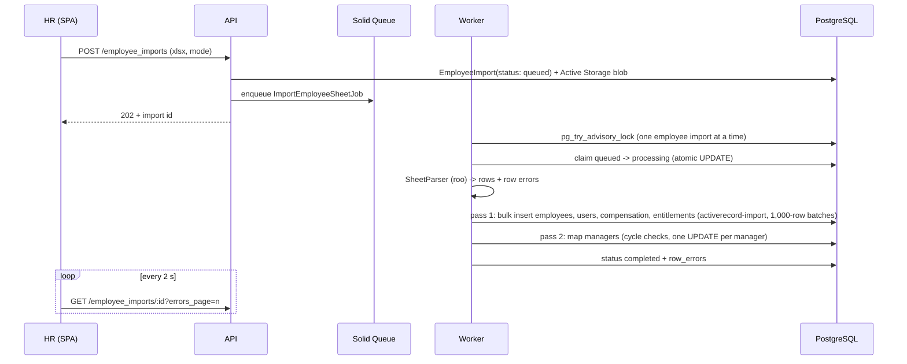
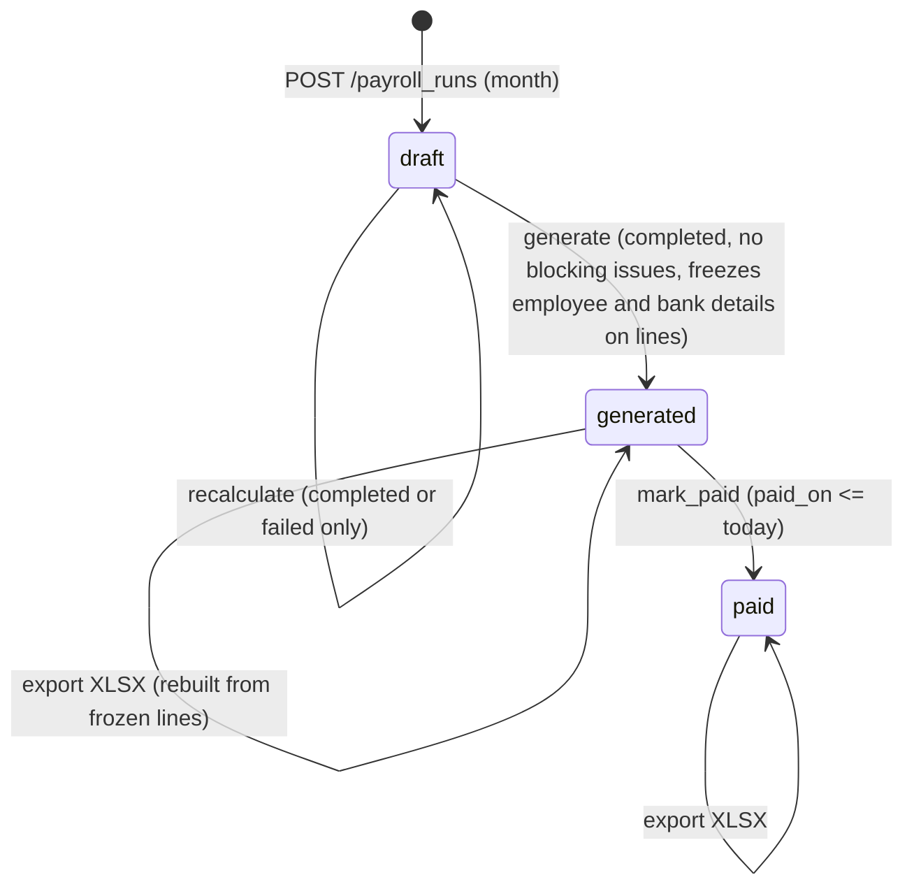
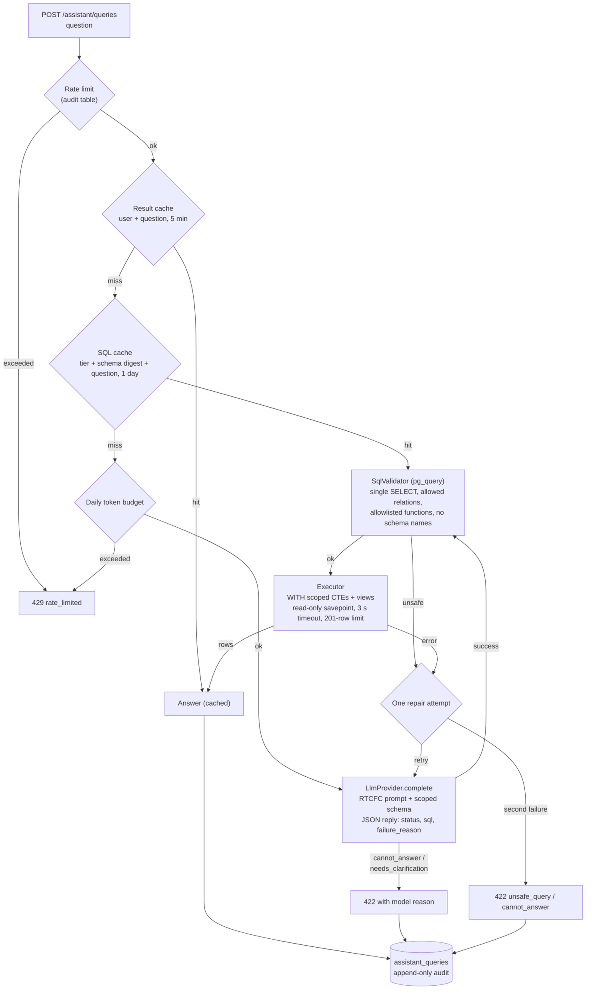
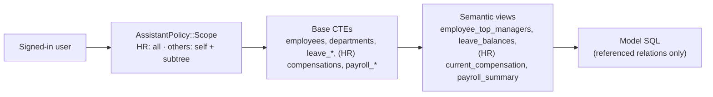
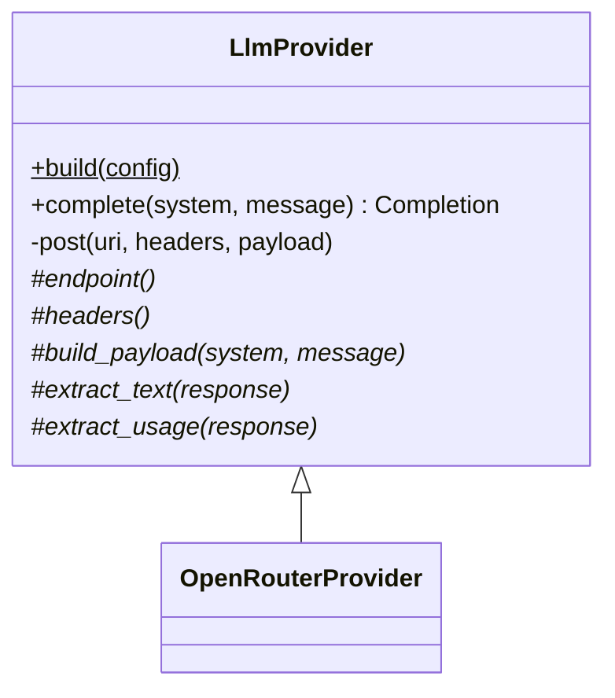
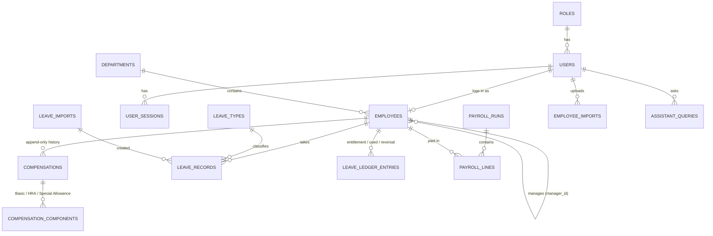
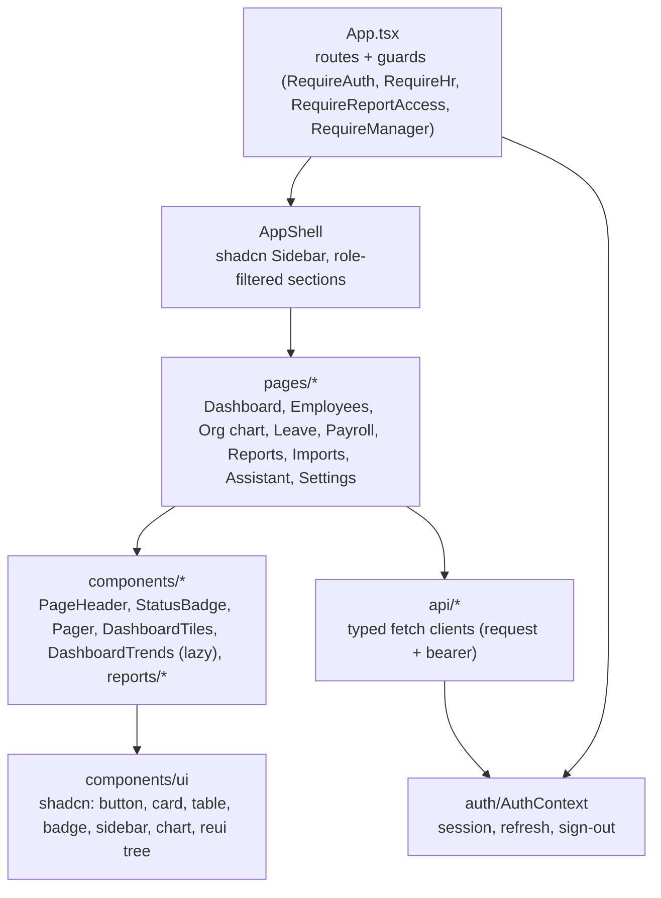

# Architecture

State as of 2026-10-28: stories S01–S06, S08–S11, S11a, S11b and S11c are built (S07 cut). Diagrams
use Mermaid and render on GitHub and in most Markdown viewers.

## 1. System context

- The backend is API-only; the SPA is the only client. CORS is an explicit allowlist.
- Background work (leave import, employee import, payroll calculation) runs in Solid Queue, which
  stores its jobs in a separate PostgreSQL database.
- The LLM receives the scoped schema text and the question; result rows never leave the server.

## 2. Backend layers

Rules applied throughout:

- Controllers authorise (`authorize`, `policy_scope`), call one service or query object, and render
  the JSON envelope (`{ data, meta }` or `{ error: { code, message, details } }`).
- Visibility lives in policy scopes: HR sees everything; a manager sees their reporting subtree
  (`Employee#subordinate_ids`, recursive CTE); an employee sees their own records.
- Integrity lives in the database as well as the models: unique indexes, check constraints
  (statuses, positive amounts, `paid_on` when paid), foreign keys, an append-only leave ledger.

## 3. Authentication and session flow

## 4. Main workflows

### 4.1 Excel imports (leave and employees)

The leave import follows the same shape (upload -> job -> per-row validation -> ledger entries ->
summary) and keeps balances append-only.

### 4.2 Payroll

### 4.3 NL-to-SQL assistant

Scoping by construction: the model only ever names virtual relations (`employees`,
`leave_records`, `payroll_summary`, ...). Each one is a CTE built from the asker's Pundit scope and an
allowed column list, so whatever SQL is generated cannot read rows or columns outside the asker's
visibility.

Provider template pattern:

## 5. Data model (core)

## 6. Frontend structure

The SPA hides links by role for convenience only; the API enforces every rule.
